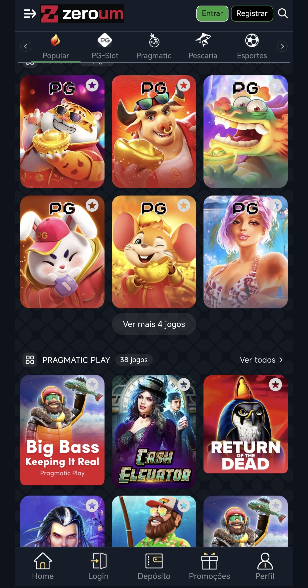

# 🔢 Zeroum — Plataforma de Apostas/Cassino (Laravel)

> **Plataforma "01" (Zeroum) de apostas/cassino em Laravel** — Filament/Livewire, admin, afiliados, depósitos e painéis.

---

## 🚀 Visão Geral

Plataforma **Zeroum ("01")** de apostas/cassino em **Laravel 10** com
**Filament + Livewire** para painéis. Inclui painel administrativo (`/dash`),
painel de afiliados (`/afiliado`), módulos opcionais (`LandingSpin`), assets
de jogo e Vite build. Uma das bases Laravel mais completas da coleção
(vendor + node_modules + stubs + tests inclusos).

## ✨ Funcionalidades

| Módulo | Descrição |
|---|---|
| 🎰 **Apostas/Cassino** | `app`, `resources/views` |
| 🛠️ **Admin** | Filament + `/dash` |
| 🤝 **Afiliados** | Painel `/afiliado` |
| 🧩 **Módulos** | `modules_statuses.json` (LandingSpin) |
| 🗄️ **Banco** | `BANCO DE DADOS AQUI/zeroum.sql` |
| 🎨 **Assets** | `assets/`, `public/`, Vite + Tailwind |
| ⚙️ **Config** | `config/`, `routes/`, `database/` |

## 🛠️ Stack

- **Backend:** Laravel 10 (Filament, Livewire, Enums, Events, Notifications)
- **Frontend:** Blade + Vite + Tailwind
- **Banco:** MySQL

## ⚙️ Configuração

1. Importar `BANCO DE DADOS AQUI/zeroum.sql`.
2. Configurar `.env` e rodar `artisan migrate`/build.
3. Acessar `/dash` (admin) e `/afiliado`.

---

## 🖼️ Prévia

  
  

## ⬇️ Download

📦 **[Release v1.0](https://github.com/VSFLima/zeroum/releases/tag/v1.0)**

| Arquivo | Tamanho |
|---|---|
| [`Zeroum_ecompag.zip`](https://github.com/VSFLima/zeroum/releases/download/v1.0/Zeroum_ecompag.zip) | 180 MB |

## 🙏 Créditos

- **Distribuição:** [@vsf_lima](https://t.me/vsf_lima) — Telegram
- **Sistema original:** ecompag / datafy.click
